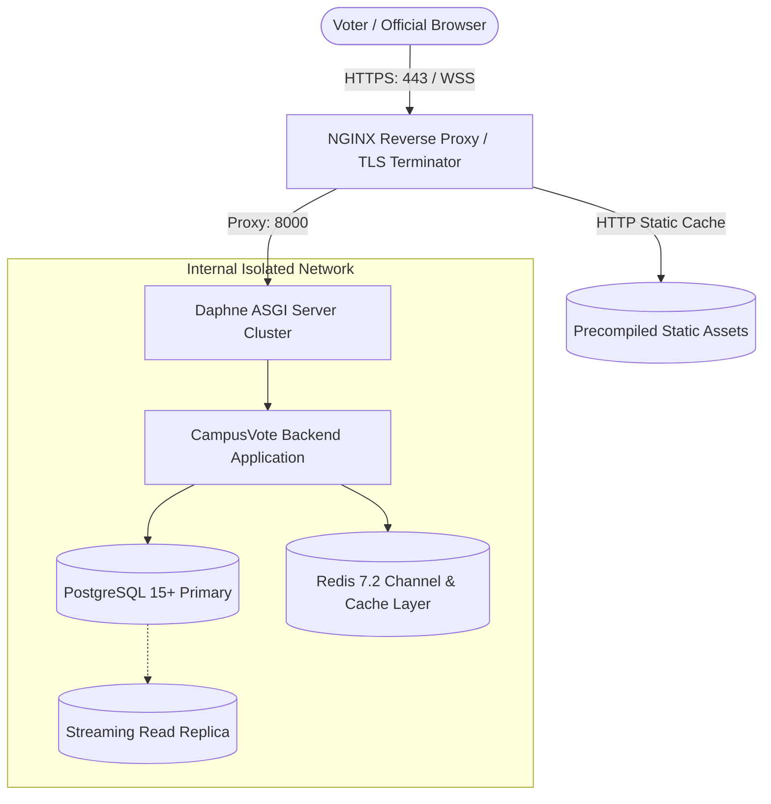

# CampusVote Production Deployment Guide

> **ENVIRONMENT NOTICE**  
> This document distinguishes between **verified development procedures** (currently active and tested) and **proposed production steps** (required when promoting to an institutional data center or cloud host).

---

## 1. Environment Configuration & Variables

Production deployments require a securely generated `.env` file located outside the source tree or injected via container orchestration secrets (Kubernetes Secrets, AWS Secrets Manager, or Vault).

### Environment Variable Matrix

| Variable | Default (Dev) | Production Requirement | Verified Status |
| :--- | :--- | :--- | :--- |
| `DEBUG` | `True` | `False` (Mandatory) | Verified via `check --deploy` |
| `DJANGO_SECRET_KEY` | Development placeholder | 64+ character random string (Fails startup if default) | Verified in settings validator |
| `DB_ENGINE` | `sqlite` | `postgresql` | Verified (PostgreSQL drivers configured) |
| `DB_NAME` | `campusvote.sqlite3` | `campusvote` | Production standard |
| `DB_USER` | `campusvote` | Dedicated least-privilege DB user | Production standard |
| `DB_PASSWORD` | `securepassword` | Cryptographically random secret | Production standard |
| `DB_HOST` | `localhost` | Internal DB service DNS or IP | Production standard |
| `DB_PORT` | `5432` | `5432` | Production standard |
| `REDIS_URL` | None (InMemory fallback) | `redis://:password@redis-host:6379/0` | Verified via Channels config |
| `QR_HMAC_SECRET` | Development placeholder | 64+ character secret for QR challenge signing | Verified in QR service |
| `VERIFICATION_DELIVERY_PROVIDER` | `mock` | `email` or `sms` | Enforced (Mock blocked in prod) |
| `EMAIL_HOST` | `localhost` | Institutional SMTP server | Standard Django SMTP |
| `EMAIL_PORT` | `587` | `587` (TLS) | Standard Django SMTP |
| `EMAIL_HOST_USER` | `""` | Institutional notification account | Standard Django SMTP |
| `EMAIL_HOST_PASSWORD` | `""` | SMTP password / app secret | Standard Django SMTP |
| `ALLOWED_HOSTS` | `127.0.0.1,localhost` | Explicit domain (e.g., `vote.institution.edu`) | Verified |
| `CORS_ALLOWED_ORIGINS` | `http://localhost:5173` | Explicit HTTPS origin (e.g., `https://vote.institution.edu`) | Verified |
| `CSRF_TRUSTED_ORIGINS` | `http://localhost:5173` | Explicit HTTPS origin (e.g., `https://vote.institution.edu`) | Verified |
| `SECURE_SSL_REDIRECT` | `False` | `True` (Enforced when `DEBUG=False`) | Verified |
| `SECURE_HSTS_SECONDS` | `0` | `31536000` (1 Year, Enforced when `DEBUG=False`)| Verified |

---

## 2. Infrastructure Architecture & Services



---

## 3. Production Deployment Procedures (Proposed Steps)

### Step 1: Pre-Deployment Build & Verification
1. Install backend requirements in a clean virtual environment or container image:
   ```bash
   pip install --no-cache-dir -r backend/requirements.txt
   ```
2. Compile and minify the frontend production assets:
   ```bash
   cd frontend
   npm ci
   npm run build
   ```
   *Output*: Static assets located in `frontend/dist/`.

3. Collect Django backend static assets (for Django admin and browsable API):
   ```bash
   python backend/manage.py collectstatic --noinput
   ```

### Step 2: Database Migration & Verification
Execute migrations against the production PostgreSQL database:
```bash
python backend/manage.py migrate --noinput
```
Verify that no pending migrations remain:
```bash
python backend/manage.py makemigrations --check
```

### Step 3: Run System Security Verification Checks
Run the Django deployment security check to ensure all SSL, HSTS, and secret flags are active:
```bash
python backend/manage.py check --deploy
```

### Step 4: Process Execution via ASGI
Start the Daphne ASGI server with multi-worker concurrency:
```bash
daphne -b 127.0.0.1 -p 8000 config.asgi:application
```
*Note*: For high-concurrency production deployments, run 4–8 Daphne workers behind an NGINX load balancer.

---

## 4. HTTPS & TLS Hardening

* **TLS Protocol**: TLSv1.3 only; TLSv1.2 permitted with high-grade forward-secret ciphers. TLSv1.0 and v1.1 are strictly forbidden.
* **HTTP Strict Transport Security (HSTS)**: Preload and Subdomain coverage enabled for 1 year (`31536000` seconds).
* **Cookie Flags**:
  * `SESSION_COOKIE_SECURE = True`
  * `CSRF_COOKIE_SECURE = True`
  * `SESSION_COOKIE_HTTPONLY = True`
  * `SESSION_COOKIE_SAMESITE = 'Lax'`

---

## 5. Backup, Disaster Recovery & Retention

### 5.1 Database Backup Strategy
* **Continuous Archiving**: Enable PostgreSQL Write-Ahead Logging (WAL) archiving with point-in-time recovery (PITR).
* **Pre-Election Snapshot**: Take a full physical database backup prior to opening any scheduled election.
* **Post-Election Freeze**: Following official result publication and institutional approval, generate an immutable cryptographically hashed database export for the permanent audit archive.

### 5.2 Decoupled Data Hygiene
* Under no circumstances should database dumps or log archives be combined with auxiliary identity tables in unencrypted storage.
* Retain the structural decoupling of `AnonymousBallot` in all backup files.

---

## 6. Deployment Verification Checklist

Before opening an institutional election, verify the following:

- [ ] `DEBUG` is confirmed set to `False`.
- [ ] Unique `DJANGO_SECRET_KEY` and `QR_HMAC_SECRET` are set.
- [ ] Database is connected to PostgreSQL 15+ (`SELECT version();`).
- [ ] Redis cluster is accessible and responding to `PING`.
- [ ] `FAIL_CLOSED_VOTING_RESTRICTION_ACTIVE` is active (`True`).
- [ ] Institutional email/SMS provider is active; `MockDeliveryProvider` is disabled.
- [ ] HTTPS certificates are valid with an A+ rating on SSL Labs.
- [ ] All 182 backend tests and 81 frontend tests pass cleanly in the target staging environment.
- [ ] Health-check endpoint `/api/v1/health/` returns `{"status": "healthy"}`.
