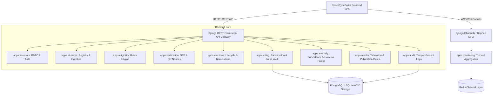
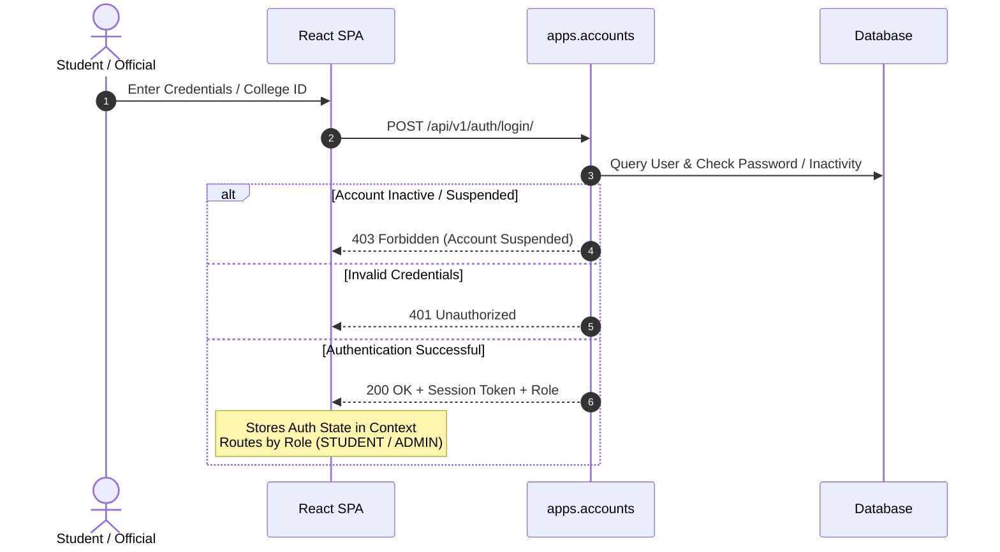
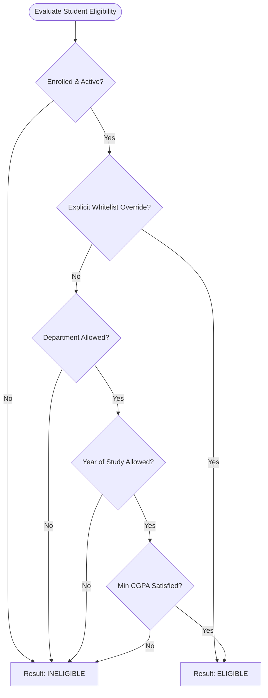
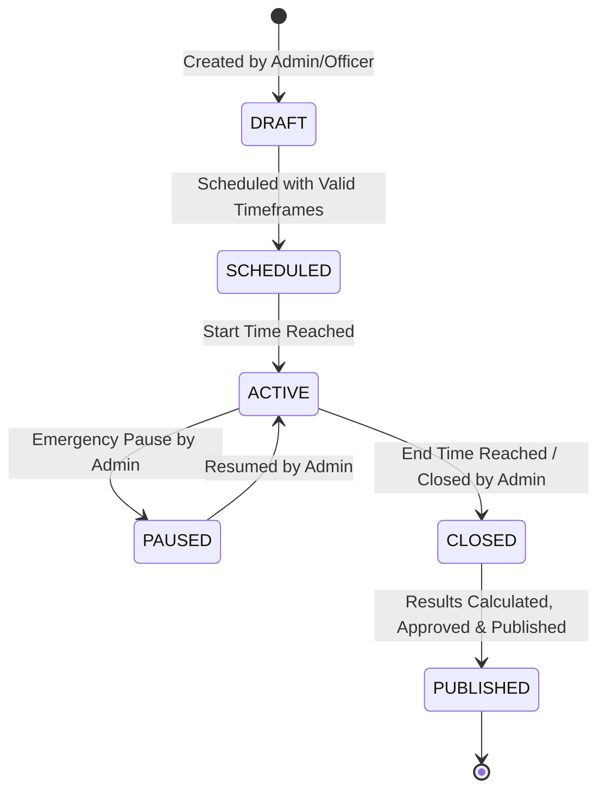
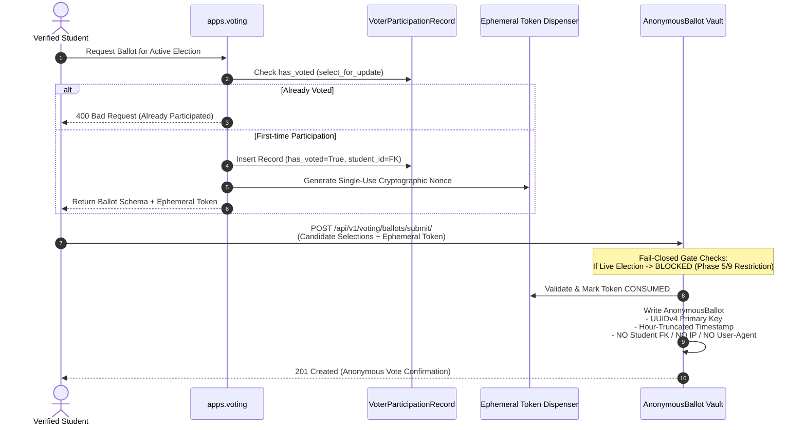
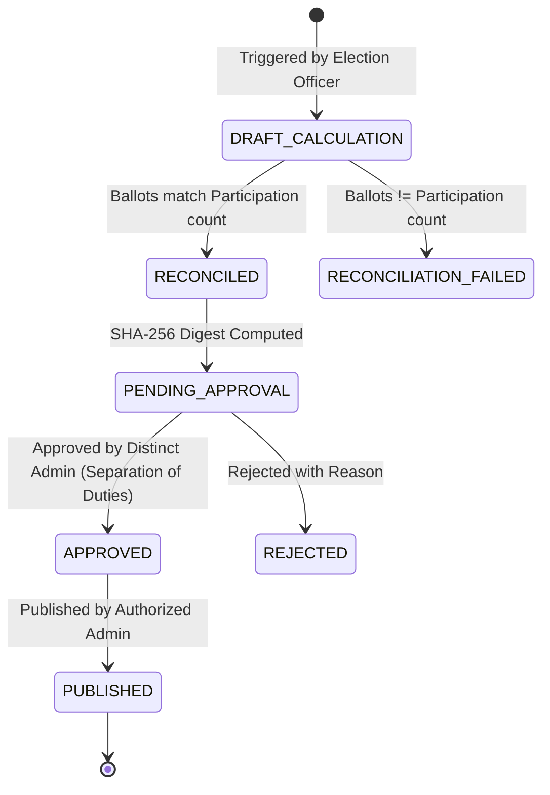

# CampusVote Technical Architecture Specification

## 1. System Overview & Monorepo Topology

CampusVote is an enterprise collegiate election management and real-time voter turnout surveillance platform. It bridges strict institutional eligibility verification with provable voter ballot privacy.

```
vote/
├── backend/                       # Django 5+ & Django REST Framework (ASGI/Daphne)
│   ├── config/                    # Settings, ASGI routing, security middleware
│   ├── apps/
│   │   ├── accounts/              # User models, authentication, RBAC
│   │   ├── students/              # Student roster, CSV import with atomic preview
│   │   ├── elections/             # Election lifecycle, positions, candidate nominations
│   │   ├── eligibility/           # Rules engine & student criteria evaluation
│   │   ├── verification/          # Dual-channel OTP & HMAC-SHA256 QR nonces
│   │   ├── voting/                # Decoupled voter participation & anonymous ballot vault
│   │   ├── monitoring/            # Real-time WebSocket aggregates & turnout metrics
│   │   ├── anomaly/               # Isolation Forest & heuristic anomaly surveillance
│   │   ├── results/               # Deterministic tabulation, artifact digests, publication gates
│   │   └── audit/                 # Append-only audit trail with redaction filters
│   ├── tests/                     # 182 comprehensive unit, integration, and E2E tests
│   └── requirements.txt           # Pinned dependencies
├── frontend/                      # React 18+ (TypeScript), Vite, Tailwind CSS, Lucide
│   ├── src/
│   │   ├── components/            # Design system (Navy/Blue, cards, tables, modals)
│   │   ├── context/               # AuthContext & WebSocket connection state
│   │   ├── pages/                 # Role-segmented routing (Public, Student, Admin)
│   │   ├── services/              # Type-safe Axios API client
│   │   └── tests/                 # 81 Vitest unit & integration test cases
│   ├── package.json
│   └── vite.config.ts
├── docs/                          # Architectural, operational, and security specifications
├── docker-compose.yml             # PostgreSQL 15 & Redis 7.2 services
├── .env.example                   # Sanitized environment configuration template
└── README.md
```

---

## 2. Component Layout & Module Boundaries



---

## 3. Data Flows & Process Lifecycles

### 3.1 Authentication & Role-Based Access Control Flow



### 3.2 Student Eligibility Evaluation Flow

The eligibility engine evaluates student attributes against composite election rules:



### 3.3 Election Lifecycle State Machine



### 3.4 Voting & Ballot Anonymity Boundary

The core privacy firewall guarantees that no correlation exists between who voted and what was cast:



---

## 4. Real-Time Turnout & Advisory Anomaly Detection Architecture

### 4.1 Turnout Aggregation & Privacy Suppression
* **WebSocket Streams**: Handled via `TurnoutConsumer` in Django Channels at `/ws/turnout/<election_id>/`.
* **Differential Privacy Filter**: To protect voter privacy in small cohorts, departments with fewer than `DEPARTMENT_PRIVACY_THRESHOLD = 5` enrolled voters have turnout counts suppressed or aggregated into "Other".
* **Zero Ballot Choice Exposure**: Analytics pipelines receive only count increments, timestamps, and department buckets. Candidate choices are never broadcast over WebSockets.

### 4.2 Advisory Anomaly Surveillance Pipeline
* **Telemetry Gatherer**: Samples submission time intervals, IP prefixes, and device user-agents.
* **Detector Suite**:
  1. *Velocity Burst Detector*: Identifies rapid bursts from identical subnet ranges.
  2. *Off-Hours Spike Detector*: Flags voting volume outside expected polling station operational hours.
  3. *Unsupervised Isolation Forest*: Evaluates multi-dimensional clustering over feature matrices.
* **Explainability & Resolution**: Every alert contains detailed heuristic evidence (`evidence_payload`). Dismissing or resolving alerts strictly requires authorized administrator notes.

---

## 5. Results Verification & Publication Workflow



### Result Artifact Digest Calculation
The cryptographic digest ensures tamper detection across result versions:
$$\text{Digest} = \text{SHA-256}\left(\text{election\_id} \parallel \text{version\_number} \parallel \text{sorted\_candidate\_tallies} \parallel \text{reconciliation\_status}\right)$$
Any direct alteration to candidate tallies in the database breaks digest validation, resulting in `INTEGRITY_COMPROMISED`.

---

## 6. Development vs. Production Dependencies

| Component | Development Environment | Production Target |
| :--- | :--- | :--- |
| **Database** | SQLite 3 (zero configuration) | PostgreSQL 15+ with row-level locking |
| **Channel Layer** | InMemoryChannelLayer | Redis 7.2 Cluster |
| **Verification** | `MockDeliveryProvider` (in-memory) | Institutional SMTP / SMS Gateway |
| **ASGI Server** | Daphne dev server / `manage.py runserver` | Multi-worker Daphne / Gunicorn behind NGINX |
| **Static Assets** | Vite HMR (`127.0.0.1:5173`) | Precompiled static assets via WhiteNoise / CDN |
| **TLS / SSL** | Plain HTTP (localhost) | Strict HTTPS with HSTS Preload |
